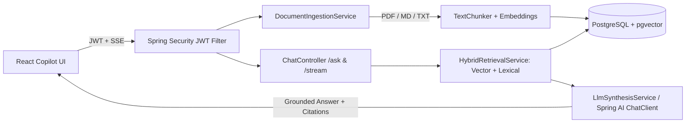

# Enterprise RAG & Citation AI Copilot

[](https://github.com/srimannarayanavarmaracha/enterprise-rag-ai-copilot/actions/workflows/ci.yml)


An enterprise Retrieval-Augmented Generation (RAG) knowledge platform built with **Java 21, Spring Boot 4.2, Spring AI 2.1, Spring Security (Stateless JWT), PostgreSQL (`pgvector`), and React + TypeScript**.

## Architecture



## Key Engineering Highlights

- **Hybrid Retrieval (`0.65` Dense Vector + `0.35` Lexical Overlap):** Combines cosine similarity over embeddings with exact keyword matching so technical identifiers, error codes, and conceptual queries both rank accurately.
- **Pluggable Spring AI Provider + Graceful Offline Mode:** Supports **OpenAI** or **Google GenAI (Gemini)** via `AI_CHAT_PROVIDER` / `OPENAI_API_KEY` / `GEMINI_API_KEY`, and degrades cleanly to deterministic grounded citation synthesis for local/CI runs without external API keys.
- **SSE Token Streaming (`/api/v1/chat/stream`):** Uses Java 21 virtual threads to stream citations, answer tokens, and retrieval latency metrics over Server-Sent Events.
- **Stateless JWT Security:** BCrypt password hashing + HMAC-SHA256 JWT authentication protecting ingestion and query endpoints.

## Quick Start (Docker Compose)

```bash
cp .env.example .env
# Optional: set AI_CHAT_PROVIDER=openai (or google-genai) and your API key in .env
docker compose up --build
```
- **React Copilot UI:** `http://localhost:3001` *(pre-seeded demo user: `demo@sriman.dev` / `Demo@1234`)*
- **Backend Health:** `http://localhost:8081/actuator/health`

## API Quick Check

```bash
# 1. Authenticate and capture JWT
TOKEN=$(curl -s -X POST http://localhost:8081/api/v1/auth/login \
  -H "Content-Type: application/json" \
  -d '{"email":"demo@sriman.dev","password":"Demo@1234"}' | jq -r '.token')

# 2. Query indexed architecture runbooks with citations
curl -s -X POST http://localhost:8081/api/v1/chat/ask \
  -H "Authorization: Bearer $TOKEN" \
  -H "Content-Type: application/json" \
  -d '{"question":"How are distributed transactions handled?","topK":3}'
```

## Running Tests

```bash
cd backend && ./mvnw test
```

## License

Licensed under the [MIT License](LICENSE).
